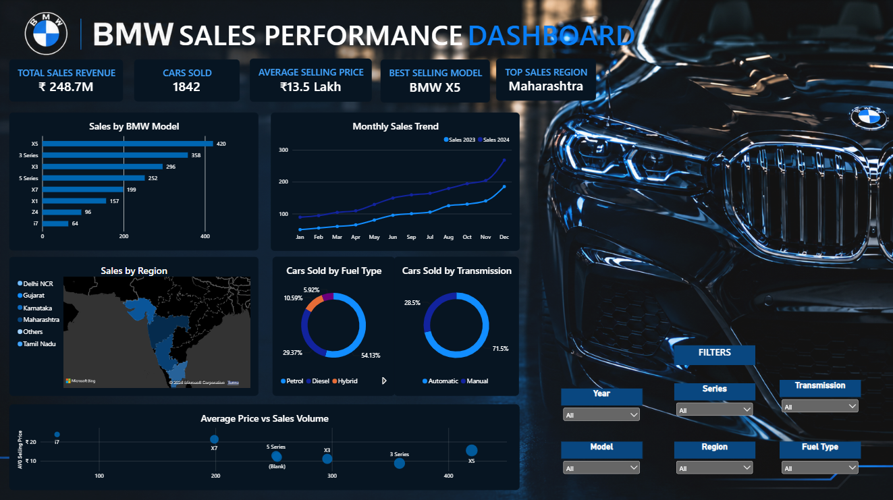

# 🚗 BMW Sales Performance Dashboard

An interactive **Power BI** dashboard that analyzes BMW sales across models, regions, fuel types and transmissions. It helps sales and management teams track revenue, identify best-selling models and understand regional and yearly performance in one view.



---

## 📌 Project Overview

This project turns raw BMW sales data into a clear visual story. The dashboard answers questions such as:

- How much revenue was generated, and how many cars were sold?
- Which BMW models and series sell the most?
- How do monthly sales in 2023 compare with 2024?
- Which regions contribute the most to sales?
- What is the split between fuel types and transmission types?
- How does average selling price relate to sales volume for each model?

---

## 📊 Key Metrics (KPIs)

| KPI | Value |
|---|---|
| Total Sales Revenue | ₹248.7M |
| Cars Sold | 1,842 |
| Average Selling Price | ₹13.5 Lakh |
| Best Selling Model | BMW X5 |
| Top Sales Region | Maharashtra |

---

## 📈 Dashboard Visuals

- **Sales by BMW Model:** bar chart ranking models (X5, 3 Series, X3, 5 Series, X7, X1, Z4, i7)
- **Monthly Sales Trend:** line chart comparing Sales 2023 vs Sales 2024
- **Sales by Region:** map showing Delhi NCR, Gujarat, Karnataka, Maharashtra, Tamil Nadu and others
- **Cars Sold by Fuel Type:** donut chart (Petrol, Diesel, Hybrid and others)
- **Cars Sold by Transmission:** donut chart (Automatic vs Manual)
- **Average Price vs Sales Volume:** scatter/bubble chart comparing price and volume by model
- **Interactive Filters:** Year, Series, Transmission, Model, Region and Fuel Type slicers

---

## 💡 Key Insights

- **BMW X5** is the best-selling model with **420 units**, followed by the 3 Series (358) and X3 (296)
- **Maharashtra** is the top sales region
- **Petrol cars make up 54.13%** of sales, followed by Diesel at 29.37%
- **Automatic transmission dominates** with **71.5%** of cars sold
- Sales show a **steady upward trend through the year**, with 2024 consistently above 2023
- The **i7** has the lowest volume (64 units), while the X5 leads on volume

---

## 🛠️ Tools & Technologies

- **Power BI Desktop:** data modelling and dashboard design
- **Power Query:** data cleaning and transformation
- **DAX:** KPI and time-comparison measures
- **Excel / CSV:** source data

---

## 🧮 Sample DAX Measures

```DAX
Total Sales Revenue = SUM(Sales[Revenue])

Cars Sold = COUNTROWS(Sales)

Average Selling Price = DIVIDE([Total Sales Revenue], [Cars Sold])

Sales 2023 =
CALCULATE([Cars Sold], 'Date'[Year] = 2023)

Sales 2024 =
CALCULATE([Cars Sold], 'Date'[Year] = 2024)

Automatic Share % =
DIVIDE(
    CALCULATE([Cars Sold], Sales[Transmission] = "Automatic"),
    [Cars Sold]
)
```

> Update table and column names to match your own data model.

---

## 📁 Repository Structure

```
BMW-Sales-Performance-Dashboard/
│
├── BMW Sales Dashboard.pbix     # Power BI report file
├── data.csv                     # Dataset (rename to match your file)
├── bmw-dashboard-overview.png   # Dashboard screenshot
└── README.md
```

---

## 🚀 How to Use

1. Clone or download this repository.
2. Open the `.pbix` file in **Power BI Desktop**.
3. If prompted, update the data source path under **Transform data → Data source settings**.
4. Click **Refresh**, then use the slicers on the right to explore the data.

---

## 🎯 Skills Demonstrated

Data cleaning · Data modelling · DAX · KPI design · Dashboard design · Data storytelling

---

## 👤 Author

**Sethu Santhosh**
Aspiring Data Analyst | B.Com Computer Applications
Skills: SQL, Excel, Power BI, Python

📧 Connect with me on [LinkedIn](https://www.linkedin.com/) · [GitHub](https://github.com/sethusanthosh-analyst)

---

⭐ If you found this project useful, please give it a star!
